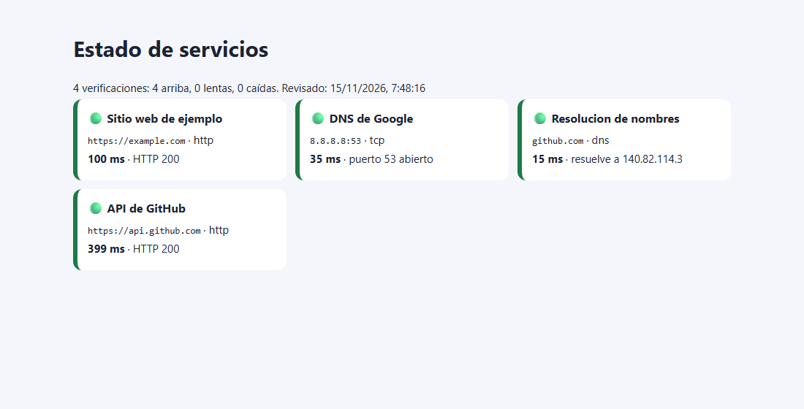

# Service Monitor

> [Versión en español](README.md)



A command-line tool that watches service availability: **websites and APIs (HTTP)**, **ports (TCP)** and **name resolution (DNS)**. It measures latency, retries before declaring a service down, computes **uptime** from history and produces console, Markdown and **HTML status page** reports.

## Features
- **HTTP** checks (expected status code and required text), **TCP** (port open) and **DNS** (name resolves).
- Configurable **timeout** and **retry**; **up / slow / down** status based on a latency threshold.
- Checks run **in parallel** with a concurrency cap.
- **History** in JSONL with uptime and average latency.
- Reports: console table, `--json`, `--md` and `--html` (content is escaped to prevent injection).
- **Exit code 1** when something is down, so it plugs into cron or CI alerts.

## Stack
Node.js 24+ with TypeScript, zero external dependencies (`fetch`, `node:net`, `node:dns`), tests with `node:test` against real local HTTP and TCP servers.

## Usage
```bash
node src/cli.ts ejemplo.json
node src/cli.ts ejemplo.json --html estado.html --md estado.md --historial historial.jsonl
npm test     # 12 tests
```
Configuration (`ejemplo.json`):
```json
[
  { "nombre": "Website", "tipo": "http", "destino": "https://example.com", "contiene": "Example Domain", "umbralMs": 1500 },
  { "nombre": "DNS server", "tipo": "tcp", "destino": "8.8.8.8", "puerto": 53 },
  { "nombre": "Resolution", "tipo": "dns", "destino": "github.com" }
]
```
Configuration keys are in Spanish (`nombre` = name, `destino` = target, `puerto` = port).

MIT License.
